# Geospatial Data

---
section: overview
sectionTitle: Overview
---

# Lecture Overview

  
  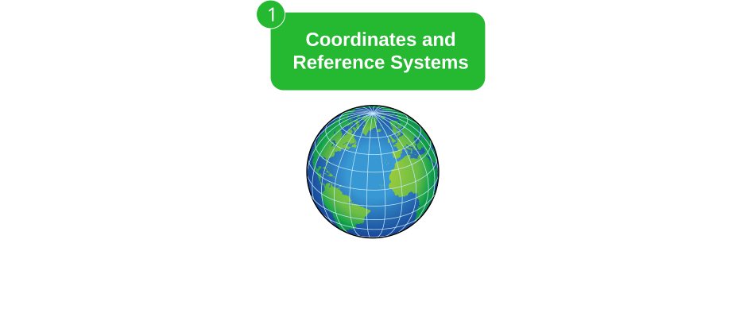
  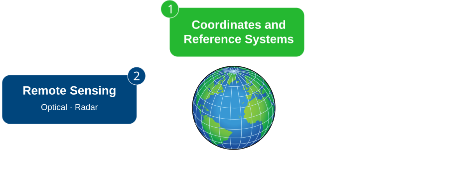
  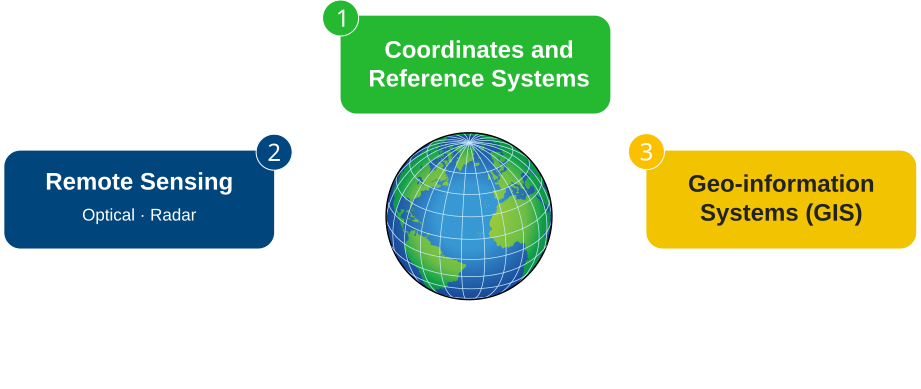
  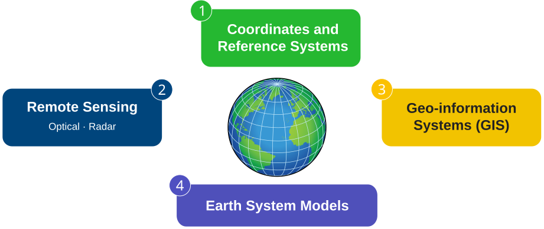

---
layout: bonn-section
sectionColor: "#23B931"
section: coordinates
sectionTitle: Coordinates
---

# Coordinates

U.S. Government — Extracted from the PDF version of the
<a href="http://www.disam.dsca.mil/pubs/archives.htm" target="_blank" rel="noopener noreferrer"><em>Vol 26-4 2004 DISAM Journal</em></a>
(direct PDF <a href="http://www.disam.dsca.mil/pubs/Archives/Web%20Journal%2026-4.pdf" target="_blank" rel="noopener noreferrer">[1]</a>),
via <a href="https://commons.wikimedia.org/wiki/File:Globe_Atlantic.svg" target="_blank" rel="noopener noreferrer">Wikipedia</a>.

---

# Cartesian Coordinates x,y,z

###

A location can be represented by three orthogonal coordinates $\mathbf{p} = (x, y, z)$ in an <a href="https://en.wikipedia.org/wiki/Earth-centered,_Earth-fixed_coordinate_system">Earth-Centered, Earth-Fixed (ECEF)</a> coordinate system

  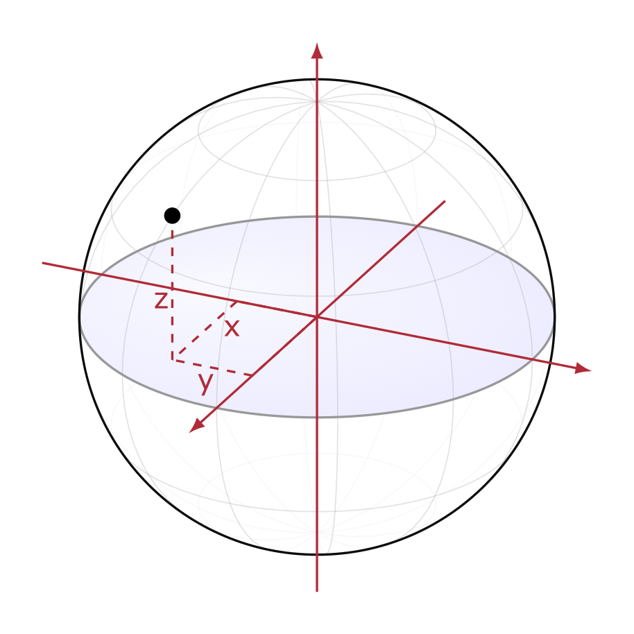

---

# Spherical Coordinates

###

Expressing location on the surface of Earth is often more practical than working directly in 3D Cartesian coordinates
$
x,y,z \mapsto \lambda, \varphi, r
$
of longitude $\lambda$, latitude $\varphi$, and constant radius $r$

Spherical to Cartesian

$$
x = r \cos\varphi \cos\lambda
$$

$$
y = r \cos\varphi \sin\lambda
$$

$$
z = r \sin\varphi
$$

Cartesian to spherical

$$
r = \sqrt{x^2 + y^2 + z^2}
$$

$$
\lambda = \operatorname{atan2}(y, x)
$$

$$
\varphi = \arcsin\left(\frac{z}{r}\right)
$$

  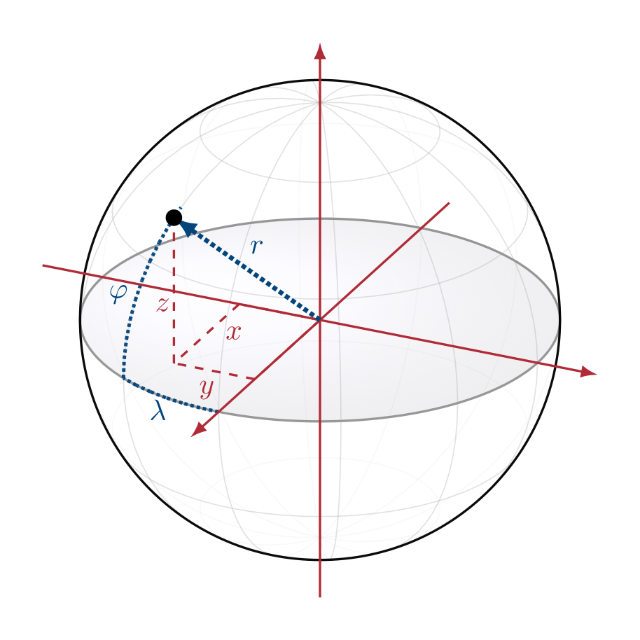

---

# Ellipsoidal Coordinates

###

But the Earth is not a sphere: It is an ellipsoid.

Geodetic to Cartesian

$$
\begin{aligned}
x &= (N(\varphi) + h)\cos\varphi\cos\lambda \\
y &= (N(\varphi) + h)\cos\varphi\sin\lambda \\
z &= \left((1-e^2)N(\varphi) + h\right)\sin\varphi
\end{aligned}
$$

$$
\begin{aligned}
N(\varphi) &= \frac{a}{\sqrt{1-e^2\sin^2\varphi}} \\
e^2 &= \frac{a^2-b^2}{a^2}
\end{aligned}
$$

Cartesian to Geodetic

The inverse is usually computed iteratively. See
<a href="https://en.wikipedia.org/wiki/Geographic_coordinate_conversion#From_ECEF_to_geodetic_coordinates" target="_blank" rel="noopener noreferrer">
Wikipedia
</a>.

  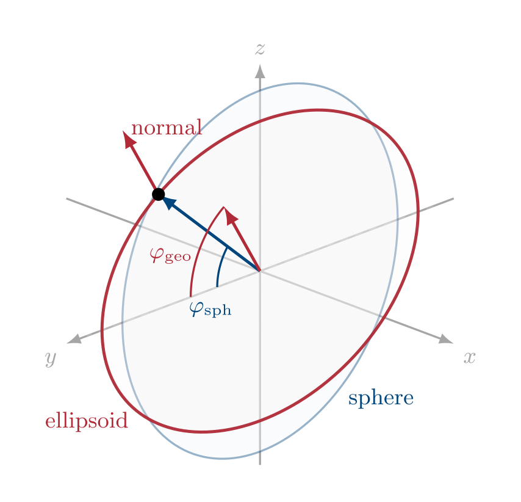

---

# World Geodetic System 1984 (WGS 84)

###

WGS 84 is the global reference system used by GPS and most web mapping workflows.

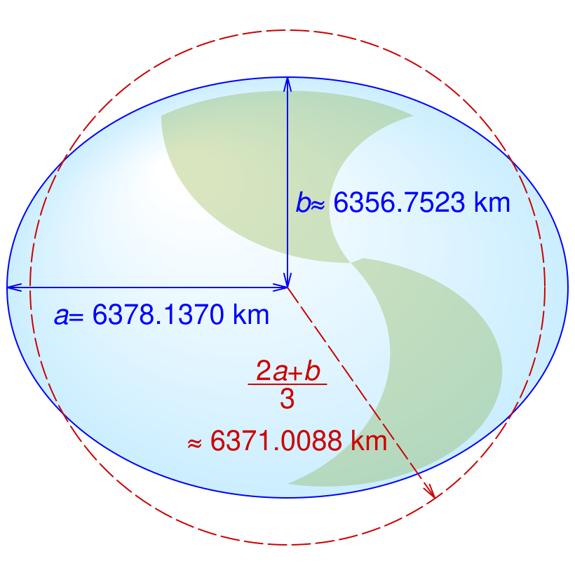

  

  

  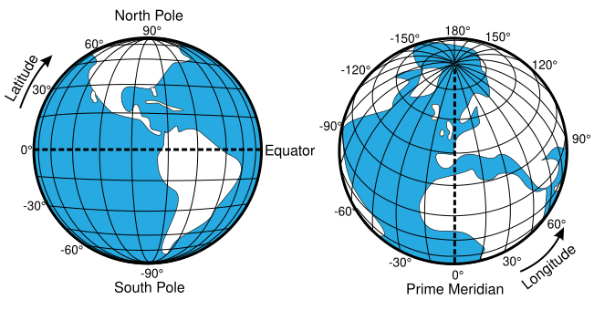

---

# Map Projections

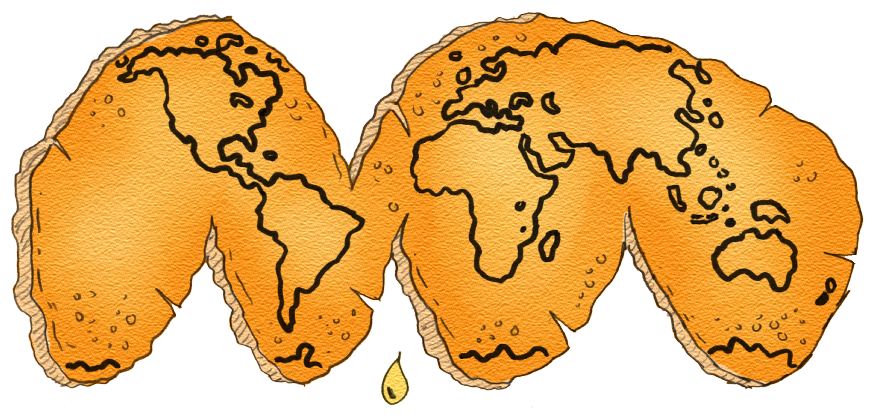

Flattening a sphere onto a plane always stretches, tears, or squashes something.

  Illustration: Michael Kline, <a href="https://dogfoose.com/2011/09/how-to-peel-a-planet/" target="_blank" rel="noopener noreferrer"><em>How To Peel a Planet</em></a>, Dogfoose.com (2011).

---
layout: bonn-two-cols-header
---

# Equal Angle vs Equal Area

::left::

No flat map can preserve all of these at once. Every projection is a **trade-off**:

<ul class="mt-2 space-y-1 list-disc pl-5">
  <li><strong>Angles</strong> (conformal), e.g. Mercator</li>
  <li><strong>Area</strong> (equal-area), e.g. Equal Earth</li>
  <li><strong>Distance</strong> (equidistant), along selected lines</li>
</ul>

On 4 September 2026, the UN General Assembly voted 164–1 to adopt the <strong>"Correct the Map"</strong> resolution. Sponsored by Togo and the African Union, the non-binding vote encourages replacing the 16th-century Mercator projection with the 2018 <strong>Equal Earth</strong> projection to represent Africa's true size.

::right::

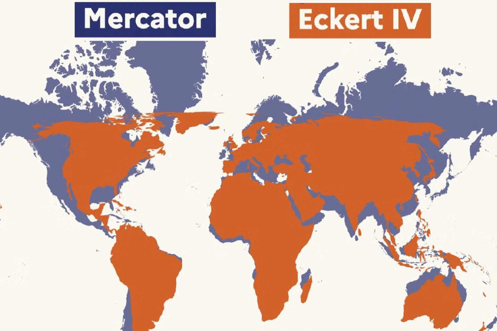

  Mercator (blue) vs an equal-area projection, Eckert IV (orange). Image: The Guardian.

---

# Cylindrical Map Projections and Web Mercator

### Cylindrical projections - Mercator

A cylinder touches or cuts the globe along a line or lines. The classic case is a cylinder around the equator.

  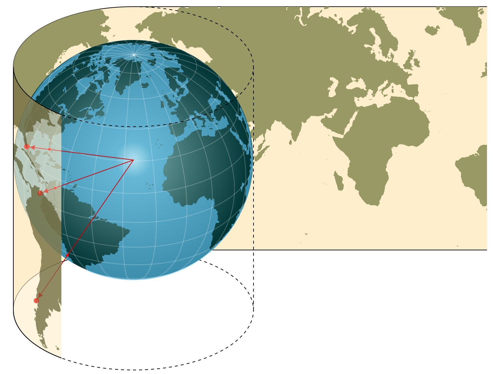

<blockquote style="margin-top: auto; min-height: 3.1rem;">
Cylindrical projections minimize distortion along their standard line(s).
</blockquote>

### Web Mercator

Web Mercator is the projection used by many web maps. It is a cylindrical, conformal projection: local shapes are preserved, but areas grow strongly toward the poles.

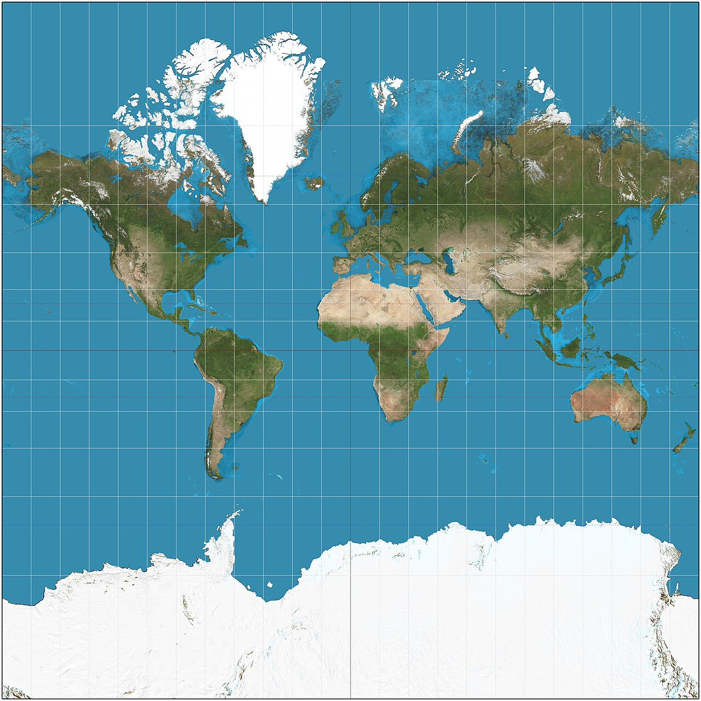

Figure: <a href="https://commons.wikimedia.org/wiki/File:Mercator_projection_Square.JPG" target="_blank" rel="noopener noreferrer">Strebe / Wikimedia Commons</a> · <a href="https://creativecommons.org/licenses/by-sa/3.0/" target="_blank" rel="noopener noreferrer">CC BY-SA 3.0</a>.

<blockquote style="margin-top: auto; min-height: 3.1rem;">
Web maps trade area accuracy for visually stable local shapes and simple tiled rendering.
</blockquote>

---

# Cylindrical Map Projections and UTM

### Cylindrical projections - UTM

The Universal Transverse Mercator system rotates the cylinder: each zone uses a transverse cylinder around a local central meridian.

  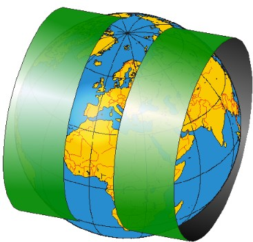

<blockquote style="margin-top: auto; min-height: 3.1rem;">
UTM turns longitude/latitude into local metric coordinates: easting and northing.
</blockquote>

### Universal Transverse Mercator (UTM)

Pre-defined UTM zones give geodata local coordinate systems with comparatively low distortion inside each zone.

  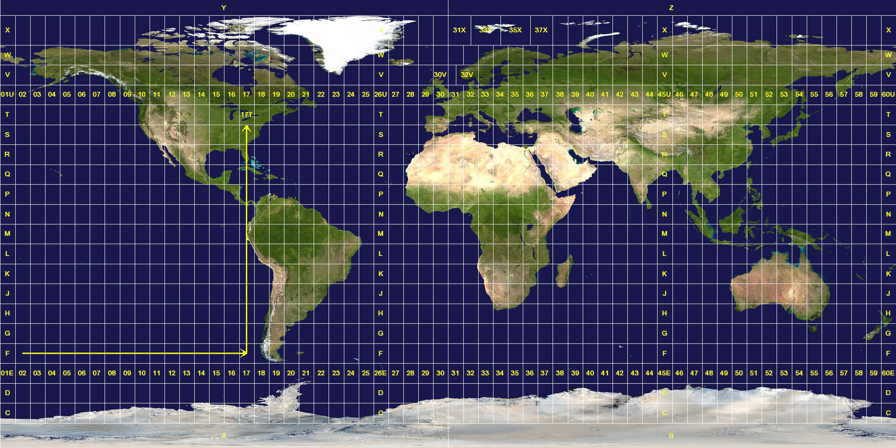

<blockquote style="margin-top: auto; min-height: 3.1rem;">
UTM uses different cylinders to avoid local distortions.
</blockquote>

---

# Radius: Atmosphere and Ocean

Geospatial fields are not only horizontal.

They also vary vertically:

- wind fields change across atmospheric columns
- ocean currents differ at the surface and at depth
- temperature, humidity, pressure, and salinity depend on height or depth
- many Earth-system processes require a vertical coordinate

<blockquote>
Location often means latitude, longitude, and height or depth.
</blockquote>

  

  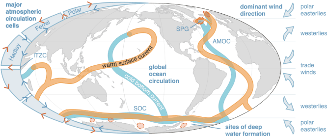
  

  

  Figure: University of Exeter, <a href="https://commons.wikimedia.org/wiki/File:Fig_1.4.1_Atmospheric_circulation_cells,_dominant_wind_directions.png" target="_blank" rel="noopener noreferrer"><em>Atmospheric circulation cells, dominant wind directions, key ocean basins, surface currents and deep water formation sites</em></a>. Licensed under CC-BY-SA: Creative Commons Attribution-Share Alike 4.0 International. The rest of this slide deck remains CC-BY-NC.
  

---

# Time: The Earth is Dynamic

  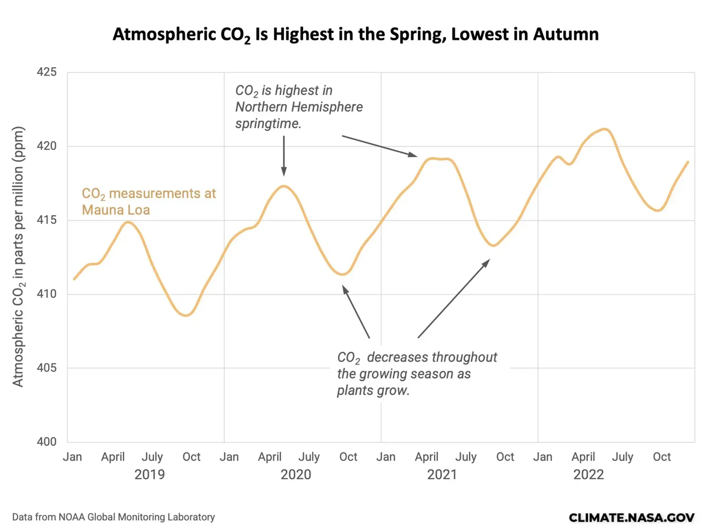
  

  Figure: NASA Science, <a href="https://science.nasa.gov/earth/explore/earth-indicators/carbon-dioxide/" target="_blank" rel="noopener noreferrer">Carbon Dioxide</a>.
  

  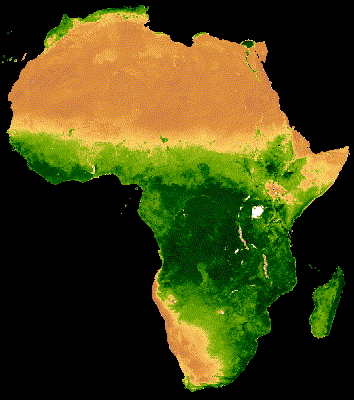
  

  Figure: Google Earth Engine, <a href="https://developers.google.com/earth-engine/tutorials/community/modis-ndvi-time-series-animation" target="_blank" rel="noopener noreferrer">MODIS NDVI time series animation</a>. Licensed under CC-BY.
  

---

# Time: Common Frequencies

###

Earth observations contain processes at many characteristic temporal frequencies.

| Time scale | Frequency | Examples |
|---|---|---|
| Seconds to minutes | High frequency | Wind gusts, turbulence, lightning, traffic, waves, sensor noise |
| Minutes to hours | Sub-daily | Cloud motion, precipitation cells, tides, urban mobility, river discharge |
| ~12 hours | Semi-diurnal | Ocean tides, coastal water levels |
| 24 hours | Daily / diurnal | Temperature cycle, solar radiation, human activity, vegetation |
| Several days | Weather | Storms, pressure systems, cloud regimes, heatwaves, cold fronts |
| Weekly | Anthropogenic | Commuting, energy use, shipping patterns, some air pollution signals |
| Monthly / ~29.5 days | Lunar | Spring-neap tide cycle, moon-related illumination effects |
| Seasonal / annual | Yearly | Phenology, crop cycles, snow cover, monsoon, sea ice, temperature |
| Interannual | 2-7 years | ENSO / El Nino, drought cycles, vegetation anomalies |
| Decadal | 10+ years | Climate variability, land-use change, glacier retreat, urban expansion |
| Multi-decadal to centennial | Long-term trend | Climate change, sea-level rise, ecosystem shifts |

---
layout: bonn-section
sectionColor: "#00457C"
section: remote-sensing
sectionTitle: Remote Sensing
---

# Remote Sensing

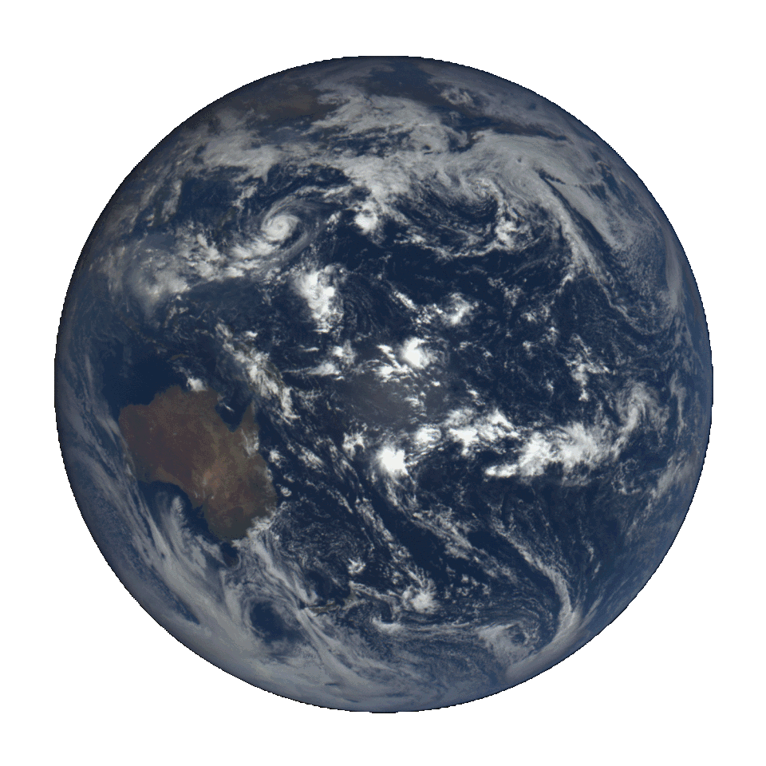

<a href="https://saylordotorg.github.io/text_essentials-of-geographic-information-systems/s05-03-geographic-information-systems.html" target="_blank" rel="noopener noreferrer">
Campbell &amp; Shin (2011), Figure 1.8.
</a>

<!--
---
section: remote-sensing
sectionTitle: Remote Sensing
---

# Overview Section - Data Formats

  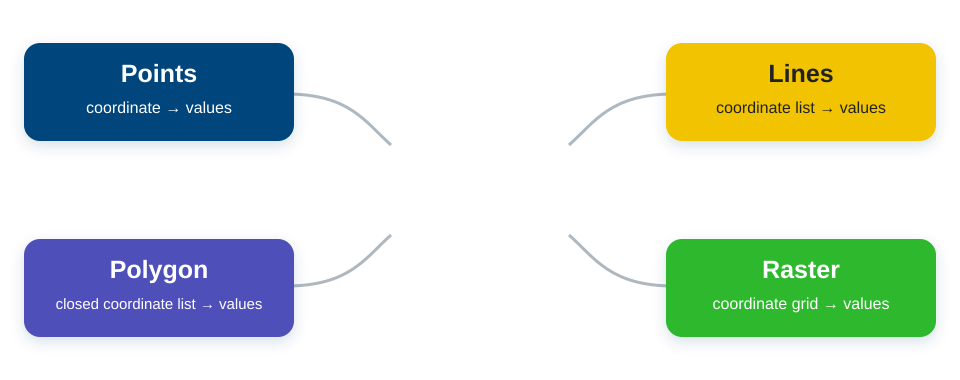
  

-->
---
section: remote-sensing
sectionTitle: Remote Sensing
---

# Lecture Overview

---
section: remote-sensing
sectionTitle: Remote Sensing
---

# Remote Sensing
## Identifying, observing, and measuring an object without coming into direct contact with it.

  <video controls preload="metadata" playsinline class="w-full h-[300px] object-contain" aria-label="Remote sensing animation from NASA's Goddard Space Flight Center" src="https://svs.gsfc.nasa.gov/vis/a030000/a030800/a030892/remote_sensing_anim-HW-3.5.26a-1080p.mp4">
    <a href="https://svs.gsfc.nasa.gov/vis/a030000/a030800/a030892/remote_sensing_anim-HW-3.5.26a-1080p.mp4">Watch the remote sensing animation</a>.
  </video>

  
Credit: NASA's Goddard Space Flight Center, Animator: <a href="https://svs.gsfc.nasa.gov/search/?people=Amy%20Moran" target="_blank" rel="noopener noreferrer">Amy Moran</a> (Global Science and Technology, Inc.), Scientist: <a href="https://svs.gsfc.nasa.gov/search/?people=Matthew%20Rodell" target="_blank" rel="noopener noreferrer">Matthew Rodell</a> (NASA/GSFC) · <a href="https://orcid.org/0000-0003-0106-7437" target="_blank" rel="noopener noreferrer">ORCID</a>

---
section: remote-sensing
sectionTitle: Remote Sensing
---

# European Earth Observation Satellites

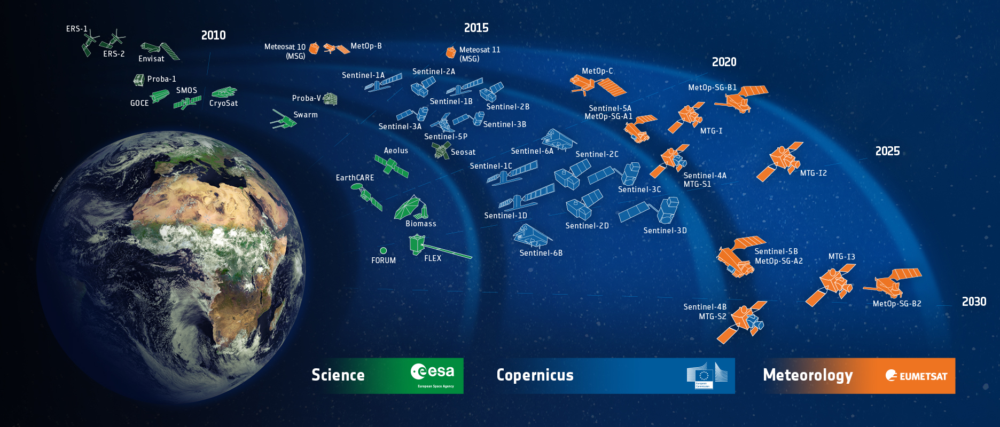

---
section: remote-sensing
sectionTitle: Remote Sensing
---

# Active and Passive Remote Sensing

## Passive Remote Sensing

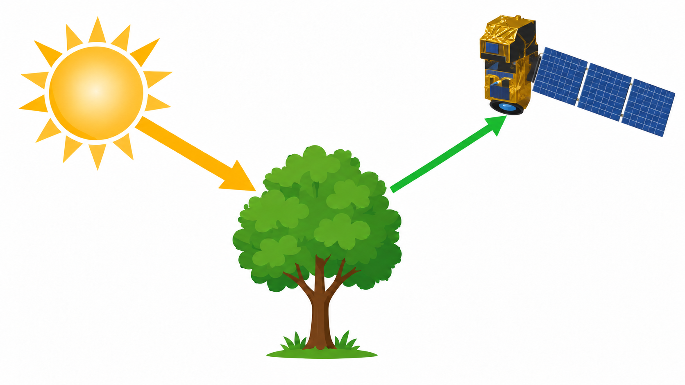

Sunlight → reflected → sensed by the satellite

<strong class="text-blue-800">Example:</strong> optical satellites

## Active Remote Sensing

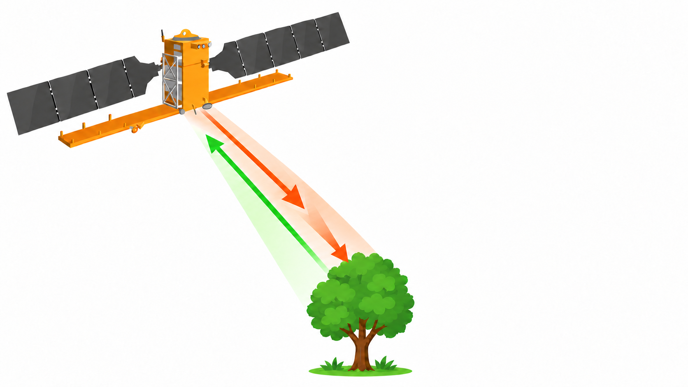

Satellite emits energy → reflected → sensed

<strong class="text-blue-800">Examples:</strong> nadir lidar and side-looking radar

<!--
Contrast passive sensors, which use sunlight, with active sensors, which emit their own signal. Use the examples to introduce optical, lidar, and radar observations.
-->

---
section: remote-sensing
sectionTitle: Remote Sensing
---

# Electromagnetic Spectrum

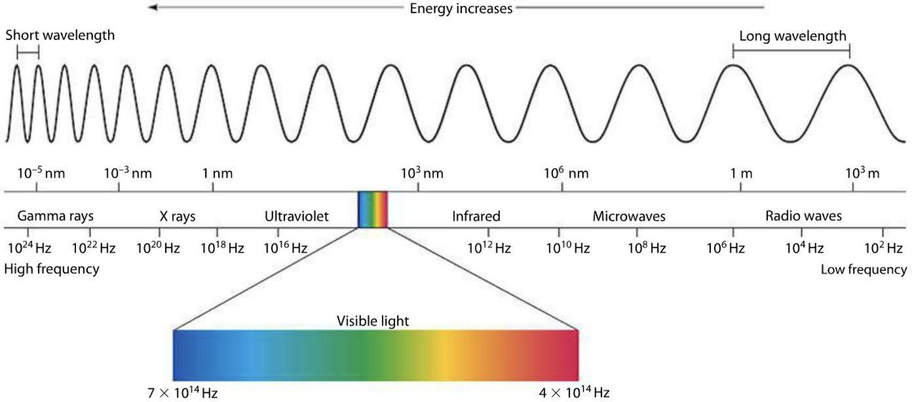

  Sources: <a href="https://earthdaily-earthone-cdn.s3.us-west-2.amazonaws.com/docs/6.0.1/public/_images/spectrum.png" target="_blank" rel="noopener noreferrer">EarthDaily</a> · <a href="https://www.miniphysics.com/electromagnetic-spectrum_25.html" target="_blank" rel="noopener noreferrer">miniphysics.com</a>

---
section: remote-sensing
sectionTitle: Remote Sensing
---

# Different Satellites - Different Spectral Bands

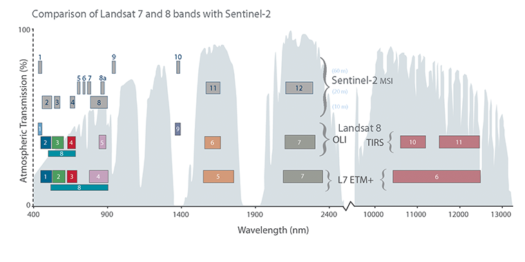

  Source: <a href="https://landsat.gsfc.nasa.gov/wp-content/uploads/2015/06/Landsat.v.Sentinel-2.png" target="_blank" rel="noopener noreferrer">NASA Landsat</a> (Public domain) · <a href="https://www.usgs.gov/media/images/comparison-landsat-7-and-8-bands-sentinel-2" target="_blank" rel="noopener noreferrer">USGS copy</a>.

---
section: remote-sensing
sectionTitle: Remote Sensing
---

# Earth Observation Satellites

## Passive Remote Sensing - Examples from 07.02.2020

  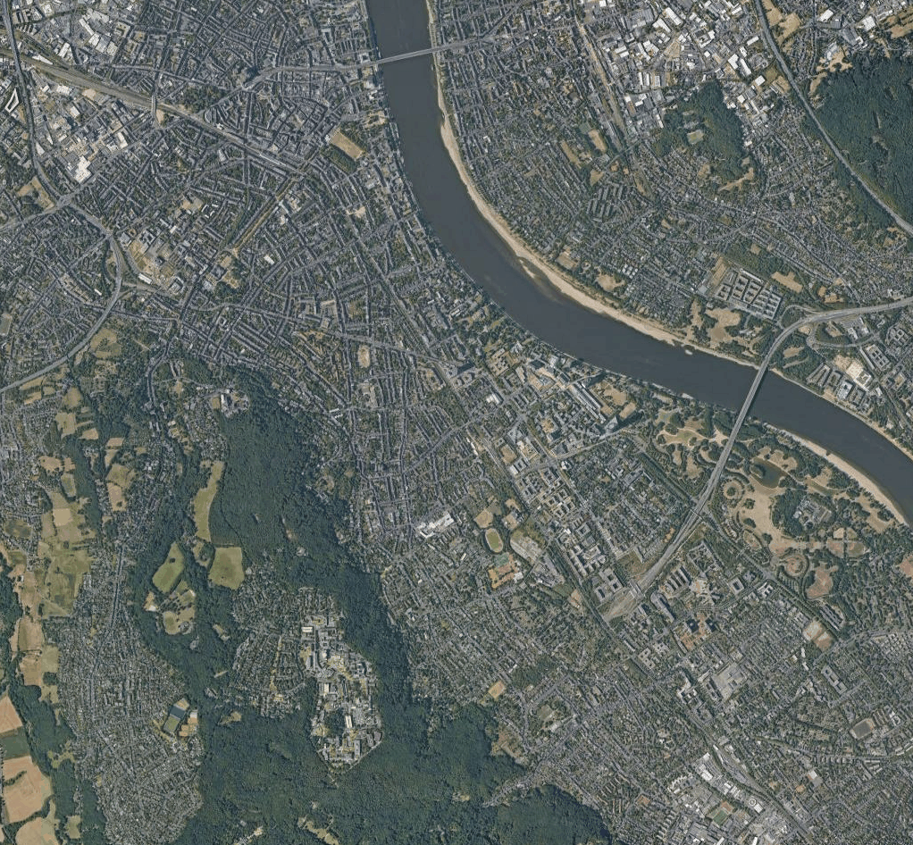
  <h3 class="mt-3">High Resolution</h3>
  
e.g., WorldView-3, PlanetScope, &lt; 10 m

  
  <h3 class="mt-3">Medium Resolution 10m-30m</h3>
  
Sentinel-2, 13-band multispectral

  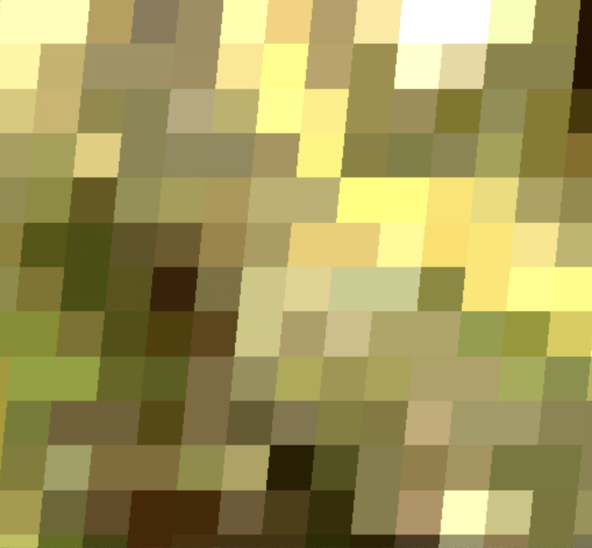
  <h3 class="mt-3">Low Resolution</h3>
  
MODIS, 250m - 1km, 36-band multispectral

---
section: remote-sensing
sectionTitle: Remote Sensing
---

# 2D Frame Camera Arrays

  

    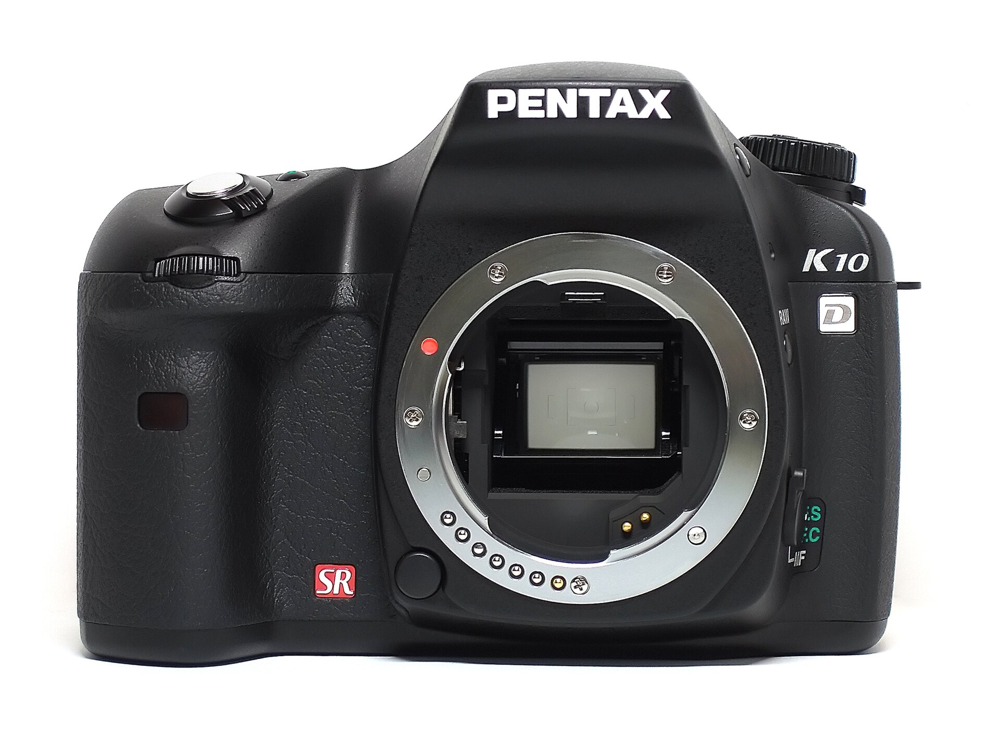
    
DSLR camera

  

  

    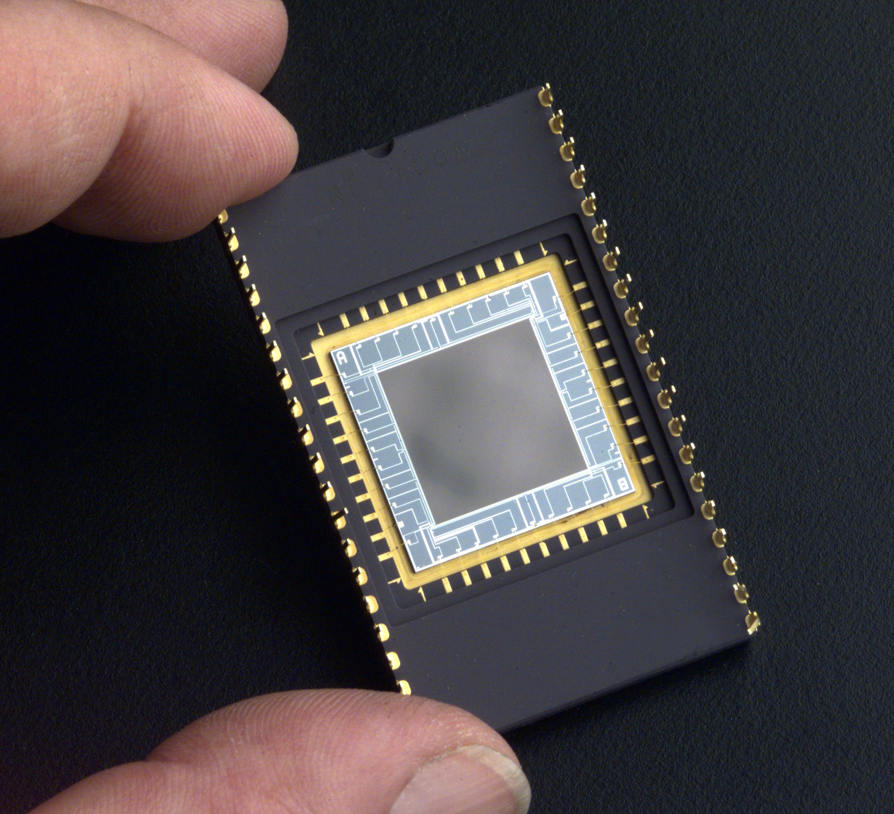
    
CCD detector

  

  
DSLR: <a href="https://commons.wikimedia.org/wiki/File:Pentax_K10D_front.jpg" target="_blank" rel="noopener noreferrer">Bill Bertram / Wikimedia Commons</a> · <a href="https://creativecommons.org/licenses/by-sa/2.5/" target="_blank" rel="noopener noreferrer">CC BY-SA 2.5</a>. CCD: <a href="https://commons.wikimedia.org/wiki/File:Delta-Doped_Charged_Coupled_Devices_(CCD)_for_Ultra-Violet_and_Visible_Detection.jpg" target="_blank" rel="noopener noreferrer">NASA/JPL / Wikimedia Commons</a> · Public domain.

---
section: remote-sensing
sectionTitle: Remote Sensing
---

# 2D Frame Camera Arrays — PlanetScope

## High-resolution satellite constellations

  

    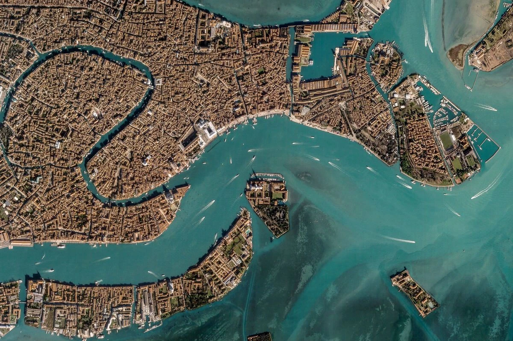
    
PlanetScope image

  

  

    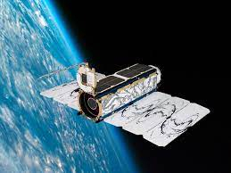
    
PlanetScope Dove

  

  
Satellite image: <a href="https://docs.planet.com/data/imagery/planetscope/thumbnail.webp" target="_blank" rel="noopener noreferrer">Planet</a>. Dove: <a href="https://eo.belspo.be/sites/default/files/styles/large/public/satellites/dove.jpg?itok=lzv1Bbke" target="_blank" rel="noopener noreferrer">BELSPO Earth Observation</a>.

<!--
The CCD photograph on the preceding slide illustrates a general sensor concept; it is not a photograph of the Dove camera sensor.
-->

---
section: remote-sensing
sectionTitle: Remote Sensing
---

# Whisk-broom Scanners

## E.g., Landsat series up to 7

  

    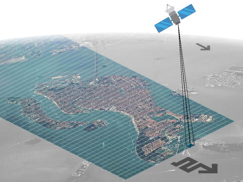
    
Whisk-broom scanning

  

  

    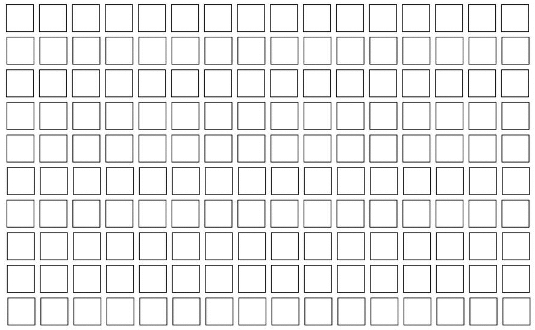
    
Building an image

  

  

    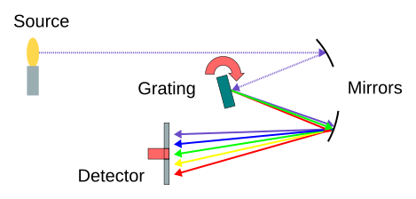
    
Spectrometer

  

  Sources: <a href="https://commons.wikimedia.org/wiki/File:Whisk_broom_satellite.svg" target="_blank" rel="noopener noreferrer">CMG Lee, Chris 73 &amp; Emoji One contributors</a> · <a href="https://commons.wikimedia.org/wiki/File:Whiskbroom_visualization.gif" target="_blank" rel="noopener noreferrer">Ccarmour</a> · <a href="https://commons.wikimedia.org/wiki/File:Spectrometer.svg" target="_blank" rel="noopener noreferrer">Jooja</a> / Wikimedia Commons · <a href="https://creativecommons.org/licenses/by-sa/4.0/" target="_blank" rel="noopener noreferrer">CC BY-SA 4.0</a>.

---

# Landsat Series

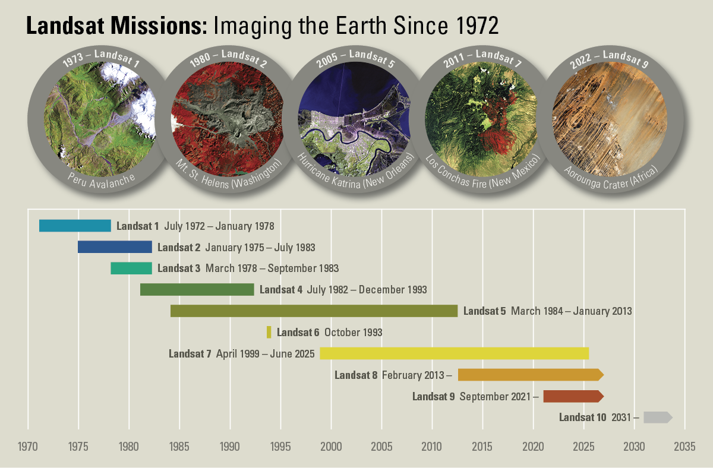

  Source: <a href="https://d9-wret.s3.us-west-2.amazonaws.com/assets/palladium/production/s3fs-public/styles/full_width/public/media/images/2026-05-8461-Landsat%20_Missions_timeline_graphic.png?itok=JhMkATIA" target="_blank" rel="noopener noreferrer">USGS — Landsat Missions</a>.

---
section: remote-sensing
sectionTitle: Remote Sensing
---

# Landsat Series — Las Vegas

  <video controls preload="metadata" playsinline class="w-full h-[320px] object-contain" aria-label="Landsat animation showing changes in Las Vegas" src="https://svs.gsfc.nasa.gov/vis/a030000/a030200/a030215/landsat_las_vegas_animation_720p.webm">
    <a href="https://svs.gsfc.nasa.gov/vis/a030000/a030200/a030215/landsat_las_vegas_animation_720p.webm">Watch the Las Vegas animation</a>.
  </video>
  

    Source: <a href="https://svs.gsfc.nasa.gov/vis/a030000/a030200/a030215/landsat_las_vegas_animation_720p.webm" target="_blank" rel="noopener noreferrer">NASA Scientific Visualization Studio — Las Vegas</a>.
  

---
section: remote-sensing
sectionTitle: Remote Sensing
---

# Push-broom Scanners

## E.g., Sentinel-2

<h2 style="font-size: 1.2rem; line-height: 1.3; height: 2em; margin: 0 0 12px;">Push-broom</h2>

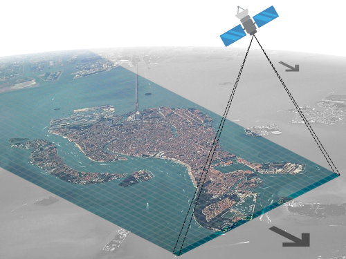

<strong>Detector row:</strong> captures a whole line at once.

<h2 style="font-size: 1.2rem; line-height: 1.3; height: 2em; margin: 0 0 12px;">Building an Image</h2>

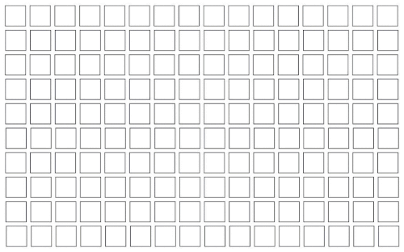

Satellite motion adds new lines → <strong>raster image</strong>.

<h2 style="font-size: 1.2rem; line-height: 1.3; height: 2em; margin: 0 0 12px;">Sentinel-2 MSI Detectors</h2>

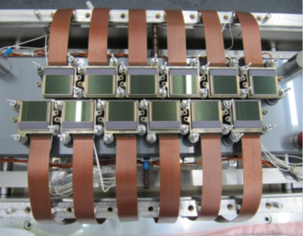

  Credit: Astrium SAS (France) and e2v Technologies (UK), via <a href="https://sentiwiki.copernicus.eu/" target="_blank" rel="noopener noreferrer">SentiWiki</a>.

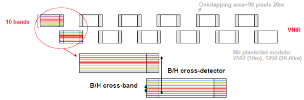

  Parallax figure derived from MSI instrument documentation, via <a href="https://sentiwiki.copernicus.eu/" target="_blank" rel="noopener noreferrer">SentiWiki</a>.

---
section: remote-sensing
sectionTitle: Remote Sensing
---

# Example Sentinel-2 Constellation

## Three Satellites (2015, 2017, and 2024)

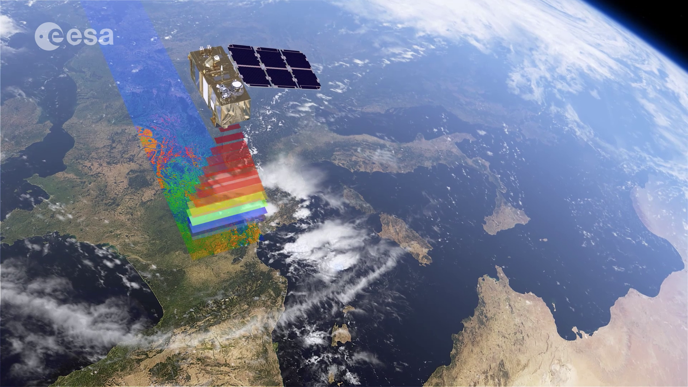

  Source: <a href="https://www.esa.int/var/esa/storage/images/esa_multimedia/videos/2015/04/mapping_in_colour/15351785-1-eng-GB/Mapping_in_colour_pillars.png" target="_blank" rel="noopener noreferrer">ESA — Mapping in colour</a>.

<video controls preload="metadata" playsinline class="w-full h-[280px] object-contain block" aria-label="ESA video about Sentinel-2" src="https://dlmultimedia.esa.int/download/public/videos/2016/08/004/1608_004_AR_EN.mp4">
  <a href="https://dlmultimedia.esa.int/download/public/videos/2016/08/004/1608_004_AR_EN.mp4">Watch the ESA Sentinel-2 video</a>.
</video>

  Source: <a href="https://dlmultimedia.esa.int/download/public/videos/2016/08/004/1608_004_AR_EN.mp4" target="_blank" rel="noopener noreferrer">ESA</a>.

---
section: remote-sensing
sectionTitle: Remote Sensing
---

# Task: Explain the Plane Rainbow

  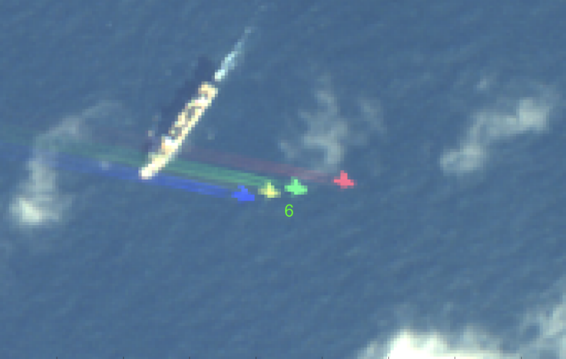

Sentinel-2 captured an aircraft flying over the sea.

Why does the plane appear **several times, in different colours**?

<blockquote>
Hint: think back to the push-broom detector layout.
</blockquote>

  Source: P. Heiselberg &amp; H. Heiselberg (2021). <a href="https://www.mdpi.com/2072-4292/13/15/3016" target="_blank" rel="noopener noreferrer"><em>Aircraft Detection above Clouds by Sentinel-2 MSI Parallax</em></a>. Remote Sensing 13(15), 3016. CC BY 4.0.

<!--
Solution: The MSI band detectors sit at different positions in the focal plane, so each band views the same ground point at a slightly different time (fractions of a second to a few seconds apart, depending on the bands) and from a slightly different angle. Static objects are co-registered on the ground, but a fast-moving aircraft at altitude has moved between the band acquisitions, and its height adds parallax. Each band therefore records the plane at a different position, producing the "rainbow" of red, green, and blue copies. Heiselberg & Heiselberg use this offset to estimate aircraft speed, heading, and altitude.
-->

---
section: remote-sensing
sectionTitle: Remote Sensing
---

# Spatial-Temporal-Spectral Juggling

Ultimately, it is about **photon energy hitting the pixels of a sensor**.

<ol class="mt-4 space-y-3 list-decimal pl-5">
  <li><strong>Spatial resolution:</strong> if a pixel covers only a small ground area, few photons are reflected into it.</li>
  <li><strong>Spectral resolution:</strong> if a pixel captures only a narrow range of wavelengths, it receives less energy, so the pixels need to be larger.</li>
  <li><strong>Temporal resolution:</strong> medium-resolution satellites capture wide swaths daily or weekly; high-resolution satellites only capture a small area per overpass.</li>
</ol>

  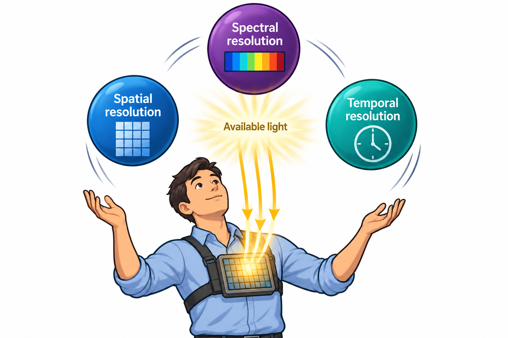
  

    Image: ChatGPT-generated.
  

---
section: remote-sensing
sectionTitle: Remote Sensing
---

# Weather and Meteorological Satellites

## Passive Remote Sensing

  

    
METEOSAT — Geostationary Orbit (~36 000 km)

    

      📍 Fixed view over Europe &amp; Africa
      🔭 500 m – 2 km
      🕐 Every 10 min
    

    <a
      href="https://zoom.earth/maps/satellite/#view=50.7,7.1,3.63z"
      target="_blank"
      rel="noopener noreferrer"
      title="Open the live Zoom Earth satellite view"
    >
      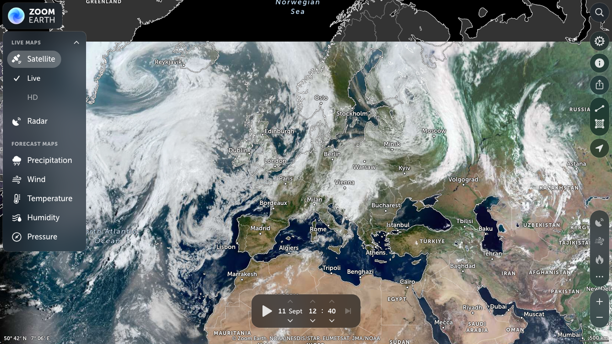
    </a>
    

      Click to open the live satellite view. Source: <a href="https://zoom.earth/maps/satellite/#view=50.7,7.1,3.63z" target="_blank" rel="noopener noreferrer">Zoom Earth</a>.
    

  

  

    
DSCOVR EPIC — L1 Lagrange Point (~1.5M km)

    

      📍 Full sunlit Earth in every image
      🔭 8 – 20 km &nbsp;·&nbsp; 🕐 Every ~2 h
    

    
    

      DSCOVR EPIC — NASA / Wikimedia Commons. Public domain.
    

  

<!--
Use the live satellite view to introduce weather satellites and broad, frequently updated coverage. Point out large-scale cloud systems and revisit the role of thermal observations.
-->

---
section: remote-sensing
sectionTitle: Remote Sensing
---

# Takeaways --- Passive Remote Sensing

Sunlight → reflected → sensed by the satellite

<strong class="text-blue-800">Example:</strong> optical satellites

<ul class="mt-2 space-y-2 text-left">
  <li>Measures <strong>reflected sunlight</strong> or <strong>heat emitted by Earth</strong>.</li>
  <li>Sunlight-based images need daylight; thermal images work <strong>day and night</strong>.</li>
  <li><strong>Clouds can block the view</strong> of the surface.</li>
  <li>Different spectral bands help distinguish <strong>water, vegetation, and built-up areas</strong>.</li>
  <li>Choose data based on the <strong>detail, coverage, and update frequency</strong> you need.</li>
</ul>

---
section: remote-sensing
sectionTitle: Remote Sensing
---

# Active Remote Sensing

## Passive Remote Sensing

Sunlight → reflected → sensed by the satellite

<strong class="text-blue-800">Example:</strong> optical satellites

## Active Remote Sensing

Satellite emits energy → reflected → sensed

<strong class="text-blue-800">Examples:</strong> nadir lidar and side-looking radar

<!--
Contrast passive sensors, which use sunlight, with active sensors, which emit their own signal. Use the examples to introduce optical, lidar, and radar observations.
-->

---
section: remote-sensing
sectionTitle: Remote Sensing
---

# Active Remote Sensing - RADAR and LIDAR

  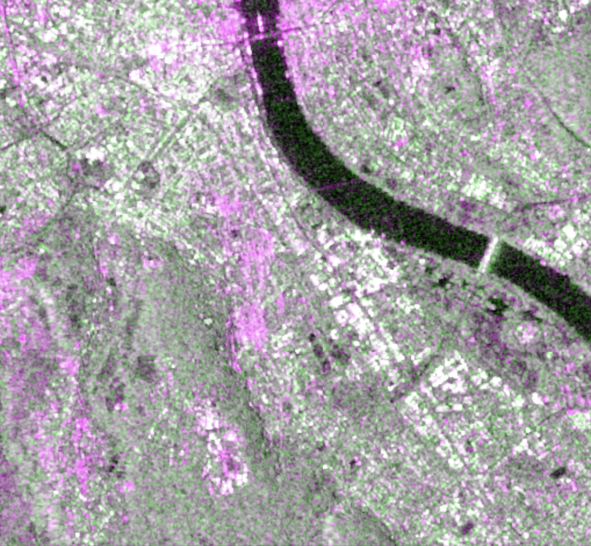
  <h3 class="mt-3">Sentinel-1 SAR Raster</h3>
  
Side-looking radar processed as a pixel grid

  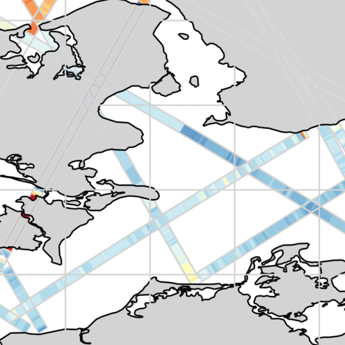
  <h3 class="mt-3">Radar Altimetry Tracks</h3>
  
Nadir measurements along point tracks

  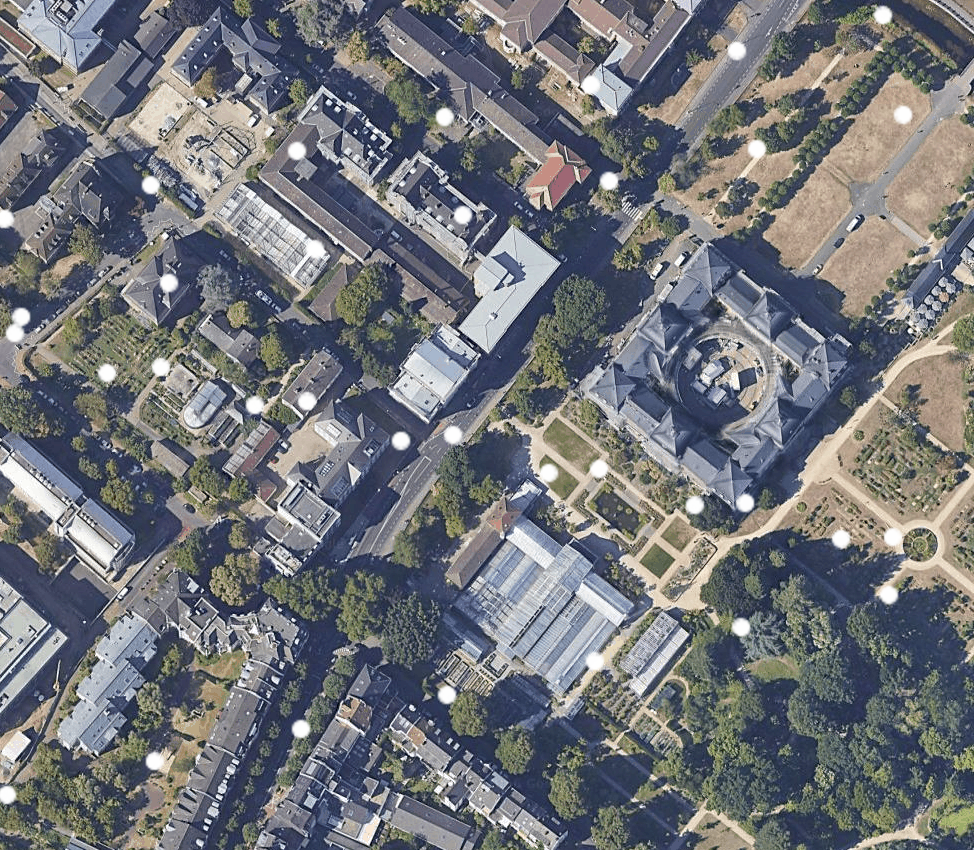
  <h3 class="mt-3">GEDI Lidar Footprints</h3>
  
Nadir samples along point tracks

<!--
Contrast Sentinel-1 imagery processed as a raster with the point tracks produced by nadir radar altimetry and GEDI lidar. Emphasize that active sensing can produce different spatial data formats.
-->

---
section: remote-sensing
sectionTitle: Remote Sensing
---

# Geometry of side-looking RADAR 

  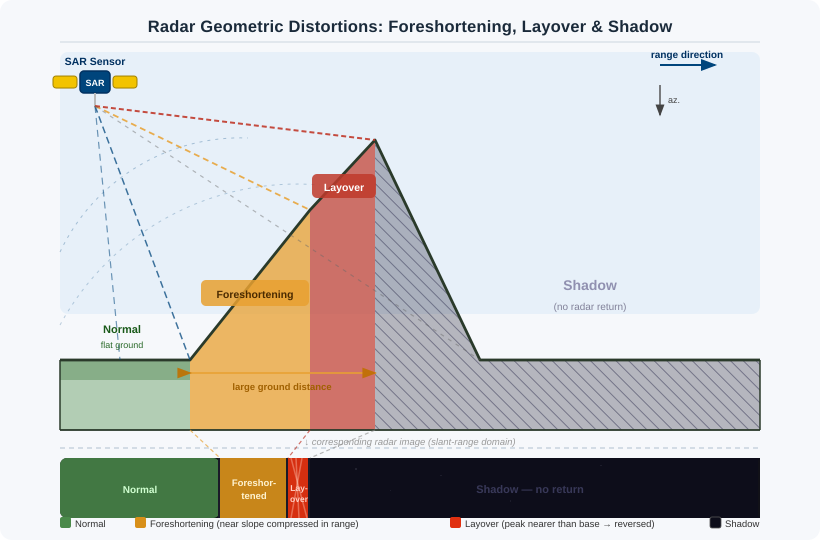

## Example: TerraSAR-X

  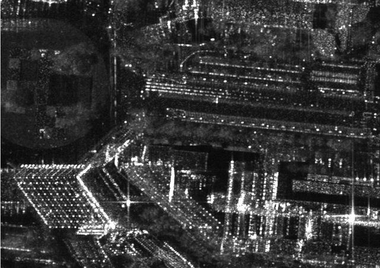

  

    Figure uploaded by
    <a href="https://www.researchgate.net/profile/Richard-Bamler" target="_blank" rel="noopener noreferrer">Richard Bamler</a>.
  

---
section: remote-sensing
sectionTitle: Remote Sensing
---

# LIDAR Backscatter for Vegetation Canopy

## Sampling Geometry

  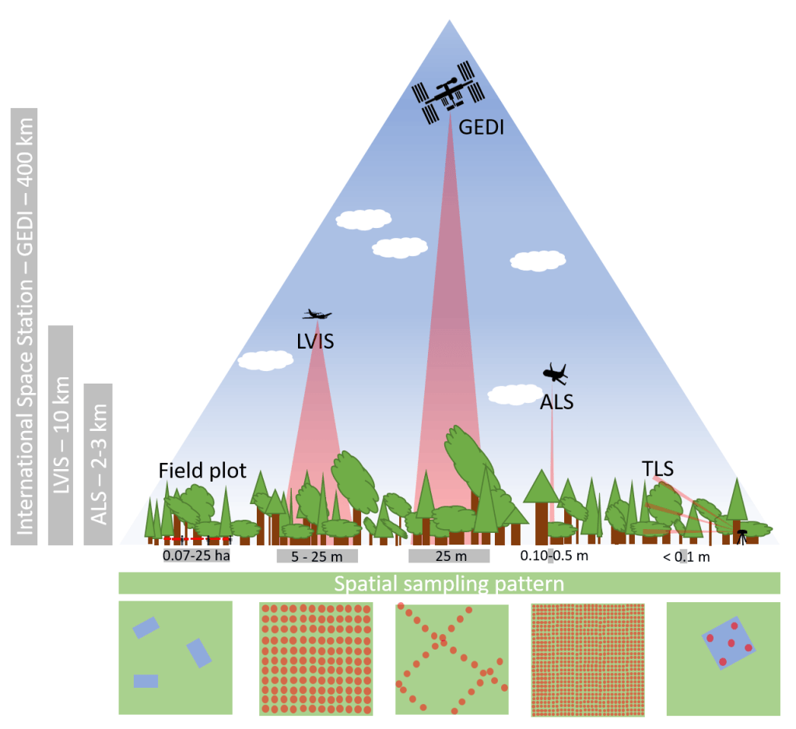

  

    Figures in both panels: NASA and University of Maryland.
  

## Canopy Structure

  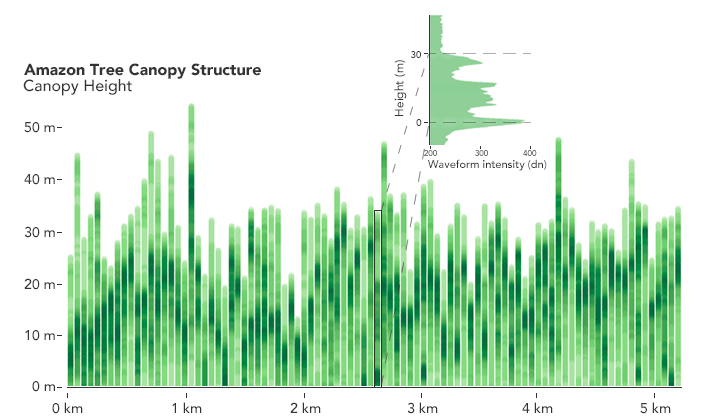

<!--
Introduce GEDI's footprint and sampling geometry before showing the resulting canopy-height profile. Connect the lidar return waveform to vertical vegetation structure.
-->

---
section: remote-sensing
sectionTitle: Remote Sensing
---

# Takeaways --- Active Remote Sensing

Sensor emits signal → return measured

<strong class="text-blue-800">Examples:</strong> SAR, LiDAR, radar altimetry

<ul class="mt-2 space-y-2 text-left">
  <li>Carries its own illumination — <strong>independent of sunlight</strong>, enabling imaging at night and in polar winter.</li>
  <li><strong>Penetrates clouds</strong> and light rain (radar), overcoming a key limitation of optical sensors.</li>
  <li>Measures <strong>physical surface properties</strong> directly: backscatter, elevation, distance, or canopy structure.</li>
  <li>SAR captures <strong>surface roughness, moisture, and deformation</strong> through phase and amplitude.</li>
  <li>Radar altimetry delivers precise <strong>surface height</strong> along nadir tracks — not a full 2D image.</li>
  <li>LiDAR records <strong>3D point clouds</strong>: tree height, building geometry, terrain beneath vegetation.</li>
  <li>Shorter wavelengths (LiDAR) give finer detail; longer wavelengths (L-band radar) penetrate canopy and soil.</li>
</ul>

<!--
Contrast with passive sensing: active sensors are self-illuminating, all-weather capable, and measure geometry and physical properties rather than reflected radiance. Emphasise night/cloud capability and the variety of active modalities: SAR, altimetry, LiDAR.
-->

---
section: remote-sensing
sectionTitle: Remote Sensing
---

# Gravity Measurements from Two Satellites

## Other Remote Sensing: Satellite Gravimetry

## GRACE Follow-On

  

    
  

  

    Figure: <a href="https://grace.jpl.nasa.gov/rails/active_storage/blobs/redirect/eyJfcmFpbHMiOnsibWVzc2FnZSI6IkJBaHBBbk1EIiwiZXhwIjpudWxsLCJwdXIiOiJibG9iX2lkIn19--d3a40f736a59795797a54a45b9897b80606fc0f3/grace-fo-satellite_768p.jpg?disposition=inline" target="_blank" rel="noopener noreferrer">NASA/JPL</a>.
  

## Ground Track

  

    
  

  

    Ground Track GRACE, January 2017. Credit: Ch. Dahle, GFZ.
  

## GRACE Geoid

  

    
  

  

    Animation: <a href="https://upload.wikimedia.org/wikipedia/commons/7/78/GRACE_globe_animation.gif" target="_blank" rel="noopener noreferrer">Wikipedia</a>; NASA/JPL/University of Texas Center for Space Research.
  

<!--
GRACE fits neither the passive nor the active category: it does not image the surface, but infers Earth's changing gravity field from two satellites flying in formation. Use the rotating geoid to show the resulting global representation.
-->

---
layout: bonn-section
sectionColor: "#F2C300"
section: geo-information-science
sectionTitle: Geo-information Science
---

# Geo-information Science

<a href="https://saylordotorg.github.io/text_essentials-of-geographic-information-systems/s05-03-geographic-information-systems.html" target="_blank" rel="noopener noreferrer">
Campbell &amp; Shin (2011), Figure 1.8.
</a>

---
section: geo-information-science
sectionTitle: Geo-information Science
---

# Lecture Overview

---
section: geo-information-science
sectionTitle: Geo-information Science
---

# We also gather a lot of Spatial Information

  
  
📍 GPS location

  

    <a href="https://commons.wikimedia.org/wiki/File:Samsung_Galaxy_S8_Duos,_Startbildschirm.JPG" target="_blank" rel="noopener noreferrer">C.Stadler/Bwag / Wikimedia Commons</a> · <a href="https://creativecommons.org/licenses/by-sa/4.0/" target="_blank" rel="noopener noreferrer">CC BY-SA 4.0</a>
  

  
  
Open city geodata: Offene Geodaten Bonn

  

    Screenshot: Offene Geodaten Bonn · Map data © OpenStreetMap contributors
  

---
section: geo-information-science
sectionTitle: Geo-information Science
---

# Vector and Raster Data

  
  
Campbell &amp; Shin (2011), Fig. 1.8

GIS organises geographic information as **stacked, queryable layers** — each layer aligns to the same coordinate reference system and carries thematic information about the world.

  

    
Vector data

    
Points, lines, polygons + attribute table

  

  

    
Raster data

    
Grids of continuous values: elevation, imagery

  

<strong class="text-gray-800">Key data sources:</strong> OpenStreetMap, administrative databases, land use / land cover classifications, cadastral records, sensor networks.

<!--
GIS organises thematic information in layers that can be overlaid, queried, and analysed spatially. Each layer is either a vector dataset (geometry + attributes) or a raster grid. Combining layers from different sources — roads, parcels, land cover, elevation — is the core power of GIS.
-->

---
section: geo-information-science
sectionTitle: Geo-information Science
---

# Raster Data

## A Grid of Cells

A raster divides space into a regular grid of <strong>cells (pixels)</strong>, each holding one value.

## Area or Center?

Does the value refer to the whole cell area or just its center? <strong>It depends on the data.</strong>

  Figures: <a href="https://desktop.arcgis.com/en/arcmap/latest/manage-data/raster-and-images/what-is-raster-data.htm" target="_blank" rel="noopener noreferrer">Esri — ArcMap documentation, <em>What is raster data?</em></a>

---
section: geo-information-science
sectionTitle: Geo-information Science
---

# Raster Coordinates

  Figure: <a href="https://desktop.arcgis.com/en/arcmap/latest/manage-data/raster-and-images/what-is-raster-data.htm" target="_blank" rel="noopener noreferrer">Esri — ArcMap documentation, <em>What is raster data?</em></a>

---
section: geo-information-science
sectionTitle: Geo-information Science
---

# Raster Georeference

Raster images are georeferenced by an affine transformation A that defines the top left coordinate with pixel sizes.

<RasterAffineDemo />

<!--
The affine transform first maps pixel-column and pixel-row coordinates to projected coordinates in EPSG:32632. Proj4 then converts each cell corner and center to EPSG:4326 for Leaflet, which expects latitude-longitude order when drawing the overlay. Leaflet retains its standard Web Mercator basemap.

These are projected grid metres. UTM has small local scale distortion, and the basemap applies its own display projection.
-->

---
section: geo-information-science
sectionTitle: Geo-information Science
---

# Task: Georeference this Image

<RasterGeorefTaskDemo />

<!--
Students must derive the six affine coefficients from the gdalinfo output. The Origin provides E₀ and N₀. Pixel Size provides a and e; north-up imagery has b = 0 and d = 0. The correct matrix is [10, 0, 365110; 0, -10, 5621210; 0, 0, 1].

The PNG is a browser-compatible rendering of the supplied 47 × 46 pixel GeoTIFF. The component maps its four image corners into EPSG:32632 and then converts them to EPSG:4326 for Leaflet. With this north-up raster, a standard Leaflet image overlay is sufficient.
-->

---
section: geo-information-science
sectionTitle: Geo-information Science
---

# Vector Data — Geometry + Attributes

  

    
🟢 Points

    
Zero-dimensional locations: weather stations, cities, GPS waypoints, species occurrence records.

  

  

    
🔵 Lines

    
Ordered vertex sequences: roads, rivers, coastlines, pipelines, power lines, flight paths.

  

  

    
🔴 Polygons

    
Closed rings enclosing area: administrative units, building footprints, land-use patches, parcels.

  

<!--
Every feature in a vector dataset combines geometry (where?) with an attribute table (what?). Spatial queries join geometry and attributes: "find all farms within 10 km of a river that are larger than 50 ha." The power of GIS lies in these combined spatial + semantic queries across multiple layers.
-->

---
section: geo-information-science
sectionTitle: Geo-information Science
---

# Explore Vector Geometries

<GeoJsonFeatureExplorer />

---
section: geo-information-science
sectionTitle: Geo-information Science
---

# Processing Geospatial Data - Locally

## GUI-based Programs

Mainly <strong>ArcGIS</strong> (commercial) and <strong>QGIS</strong> (open source).

  Image: <a href="https://qgis.org/" target="_blank" rel="noopener noreferrer">QGIS</a>

## CLI-based

  
  
<a href="https://gdal.org/" target="_blank" rel="noopener noreferrer"><strong>G</strong>eospatial <strong>D</strong>ata <strong>A</strong>bstraction <strong>L</strong>ibrary (GDAL)</a>

  Comic: <a href="https://xkcd.com/2347/" target="_blank" rel="noopener noreferrer">xkcd 2347 — Dependency</a> · <a href="https://creativecommons.org/licenses/by-nc/2.5/" target="_blank" rel="noopener noreferrer">CC BY-NC 2.5</a>. GDAL logo: <a href="https://commons.wikimedia.org/wiki/File:GDALLogoColor.svg" target="_blank" rel="noopener noreferrer">Wikimedia Commons</a>.

---
section: geo-information-science
sectionTitle: Geo-information Science
layout: bonn-two-cols-header
---

# Processing Geospatial Data - On Server Infrastructure

::left::

## Google Earth Engine

<ul class="space-y-2 list-disc pl-5">
  <li>Petabyte-scale <strong>catalog</strong> of satellite imagery, climate, and model data.</li>
  <li>Processing runs on <strong>Google's servers</strong>: the code goes to the data, not the other way round.</li>
  <li>Scripted in <strong>JavaScript</strong> (Code Editor) or <strong>Python</strong>.</li>
  <li>Free for research and education; commercial use is paid.</li>
</ul>

::right::

  Screenshot: <a href="https://code.earthengine.google.com/" target="_blank" rel="noopener noreferrer">Google Earth Engine Code Editor</a>

---
section: geo-information-science
sectionTitle: Geo-information Science
---

# Geospatial Vector Data Formats & Storage

  <svg viewBox="0 0 60 56" width="60" height="56" class="mb-1" xmlns="http://www.w3.org/2000/svg">
    <rect x="5" y="4" width="46" height="58" rx="5" fill="white" stroke="#0ea5e9" stroke-width="2"/>
    <polygon points="37,4 51,18 37,18" fill="#bae6fd"/>
    <polyline points="37,4 37,18 51,18" fill="none" stroke="#0ea5e9" stroke-width="2"/>
    <line x1="13" y1="27" x2="43" y2="27" stroke="#0ea5e9" stroke-width="2.5" stroke-linecap="round"/>
    <line x1="13" y1="35" x2="43" y2="35" stroke="#0ea5e9" stroke-width="2.5" stroke-linecap="round"/>
    <line x1="13" y1="43" x2="38" y2="43" stroke="#0ea5e9" stroke-width="2.5" stroke-linecap="round"/>
    <line x1="13" y1="51" x2="34" y2="51" stroke="#0ea5e9" stroke-width="2.5" stroke-linecap="round"/>
  </svg>
  
Text files

  

    <a href="https://www.rfc-editor.org/rfc/rfc7946.html" target="_blank" class="hover:underline underline-offset-2">GeoJSON</a><a href="https://www.ogc.org/standards/sfa/" target="_blank" class="hover:underline underline-offset-2">WKT</a> / <a href="https://www.rfc-editor.org/rfc/rfc4180.html" target="_blank" class="hover:underline underline-offset-2">CSV</a><a href="https://www.ogc.org/standards/gml/" target="_blank" class="hover:underline underline-offset-2">GML</a><a href="https://www.ogc.org/standards/kml/" target="_blank" class="hover:underline underline-offset-2">KML</a>
  

  
Readable and easy to exchange

  <svg viewBox="0 0 52 20" width="52" height="20" xmlns="http://www.w3.org/2000/svg">
    <line x1="4" y1="10" x2="43" y2="10" stroke="#94a3b8" stroke-width="2"/>
    <polygon points="43,5 52,10 43,15" fill="#94a3b8"/>
  </svg>
  more efficient

  <svg viewBox="0 0 60 56" width="60" height="56" class="mb-1" xmlns="http://www.w3.org/2000/svg">
    <rect x="8" y="48" width="44" height="14" rx="4" fill="white" stroke="#7c3aed" stroke-width="1.8"/>
    <rect x="8" y="31" width="44" height="14" rx="4" fill="white" stroke="#7c3aed" stroke-width="1.8"/>
    <rect x="8" y="14" width="44" height="14" rx="4" fill="white" stroke="#7c3aed" stroke-width="1.8"/>
    <rect x="14" y="16" width="6" height="10" rx="2" fill="#7c3aed" opacity="0.75"/>
    <rect x="22" y="16" width="4" height="10" rx="1" fill="#7c3aed" opacity="0.45"/>
    <rect x="28" y="16" width="7" height="10" rx="2" fill="#7c3aed" opacity="0.65"/>
    <rect x="14" y="33" width="8" height="10" rx="2" fill="#7c3aed" opacity="0.55"/>
    <rect x="24" y="33" width="5" height="10" rx="1" fill="#7c3aed" opacity="0.7"/>
    <rect x="31" y="33" width="4" height="10" rx="1" fill="#7c3aed" opacity="0.4"/>
    <rect x="14" y="50" width="4" height="10" rx="1" fill="#7c3aed" opacity="0.6"/>
    <rect x="20" y="50" width="8" height="10" rx="2" fill="#7c3aed" opacity="0.45"/>
    <rect x="30" y="50" width="6" height="10" rx="2" fill="#7c3aed" opacity="0.65"/>
  </svg>
  
Binary files

  

    <a href="https://support.esri.com/en-us/technical-paper/esri-shapefile-technical-description-254" target="_blank" class="hover:underline underline-offset-2">Shapefile</a><a href="https://www.geopackage.org/" target="_blank" class="hover:underline underline-offset-2">GeoPackage</a><a href="https://geoparquet.org/" target="_blank" class="hover:underline underline-offset-2">GeoParquet</a><a href="https://flatgeobuf.org/" target="_blank" class="hover:underline underline-offset-2">FlatGeobuf</a>
  

  
Compact and efficient

  <svg viewBox="0 0 52 20" width="52" height="20" xmlns="http://www.w3.org/2000/svg">
    <line x1="4" y1="10" x2="43" y2="10" stroke="#94a3b8" stroke-width="2"/>
    <polygon points="43,5 52,10 43,15" fill="#94a3b8"/>
  </svg>
  query &amp; share

  <svg viewBox="0 0 60 56" width="60" height="56" class="mb-1" xmlns="http://www.w3.org/2000/svg">
    <rect x="8" y="20" width="44" height="36" fill="white" stroke="#059669" stroke-width="1.8"/>
    <ellipse cx="30" cy="56" rx="22" ry="7" fill="#d1fae5" stroke="#059669" stroke-width="1.8"/>
    <ellipse cx="30" cy="20" rx="22" ry="7" fill="white" stroke="#059669" stroke-width="1.8"/>
    <line x1="9" y1="30" x2="51" y2="30" stroke="#059669" stroke-width="1" stroke-dasharray="4,2" opacity="0.7"/>
    <line x1="9" y1="38" x2="51" y2="38" stroke="#059669" stroke-width="1" stroke-dasharray="4,2" opacity="0.7"/>
    <line x1="9" y1="46" x2="51" y2="46" stroke="#059669" stroke-width="1" stroke-dasharray="4,2" opacity="0.7"/>
  </svg>
  
Database

  

    <a href="https://www.postgresql.org/" target="_blank" class="hover:underline underline-offset-2">PostgreSQL</a><a href="https://postgis.net/" target="_blank" class="hover:underline underline-offset-2">PostGIS</a>
  

  
Queryable and shared

  <svg viewBox="0 0 860 38" width="100%" height="38" xmlns="http://www.w3.org/2000/svg">
    <defs>
      <marker id="arrowAmber" markerWidth="9" markerHeight="9" refX="9" refY="4.5" orient="auto">
        <polygon points="0,0 9,4.5 0,9" fill="#d97706"/>
      </marker>
    </defs>
    <!-- Asymmetric bezier: starts going DOWN from database, then sweeps LEFT,
         approaching the text-files column from the right so the arrowhead points left -->
    <path d="M 840,8 C 840,34 180,34 10,12"
          fill="none" stroke="#f59e0b" stroke-width="2.5" stroke-dasharray="8,4"
          marker-end="url(#arrowAmber)"/>
  </svg>
  
<a href="https://www.ogc.org/standards/wfs/" target="_blank" class="hover:underline underline-offset-2">WFS</a> / <a href="https://ogcapi.ogc.org/features/" target="_blank" class="hover:underline underline-offset-2">OGC API Features</a>

<!--
Text-based formats are human-readable and ideal for data exchange and debugging, but verbose. Binary formats sacrifice readability for compactness and indexing; GeoParquet in particular is columnar and cloud-optimised. A PostGIS database adds SQL-based spatial queries, multi-user write access, and topology validation — at the cost of setup and infrastructure. The return arrow shows that a WFS endpoint (or the newer OGC API – Features) lets any client query a PostGIS database and receive GeoJSON or GML, closing the loop back to text-format consumers.
-->

---
section: geo-information-science
sectionTitle: Geo-information Science
---

# OpenStreetMap --- the Wikipedia of geodata

## OSM Database

Points, lines, and polygons

  
Style and rasterize

  
→

## OSM Background Map

Rendered raster tiles

Map data © OpenStreetMap contributors.

<!--
OpenStreetMap stores tagged vector features rather than a fixed map image. Styling and rasterization transform the database into familiar background-map tiles.
-->

---
section: geo-information-science
sectionTitle: Geo-information Science
---

# Web Map Service (WMS)

<WmsGetMapDemo />

<!--
Students can edit the WMS request directly. The browser requests the image only after Load map or Enter.
-->

---
section: geo-information-science
sectionTitle: Geo-information Science
---

# Web Feature Service (WFS)

<WfsGetFeatureDemo />

<!--
Unlike WMS, WFS returns features rather than pixels. The service returns GML in EPSG:4326; the tabs show equivalent GML, GeoJSON, and WKT geometry representations. GeoJSON coordinates use longitude, latitude order.
-->

---
section: geo-information-science
sectionTitle: Geo-information Science
---

# WFS/WMS in Practice

## Flightradar24

## MarineTraffic

<!--
Both applications combine a continuously updated set of geospatial features with an interactive background map. Click either screenshot to open the corresponding service.
-->

---
section: geo-information-science
sectionTitle: Geo-information Science
---

# Administrative Boundaries

  
GADM — Global Administrative Areas

  
  
Germany · 6 nesting levels · global coverage

  
Freely available polygons for every country; widely used in ecological &amp; socioeconomic modelling.

  
Gringer / Wikipedia · CC BY-SA

  
NUTS — EU Territorial Statistics Units

  
  
NUTS-1 → NUTS-2 → NUTS-3 · three nesting levels

  
EU standard: NUTS-1 (federal states), NUTS-2 (Regierungsbezirke), NUTS-3 (districts). Reference frame for Eurostat statistics.

  
© Eurostat · ec.europa.eu/eurostat

<!--
Administrative boundaries connect geographic data to the socioeconomic and political context used for statistics and policy. GADM covers the entire globe and is the default choice for global modelling studies. NUTS is EU-specific but provides strict hierarchical nesting that makes multi-scale analysis consistent. Note that boundaries change over time — NUTS was revised in 2016 and 2021, so always verify the vintage of your boundary file when doing time-series analysis.
-->

---
section: geo-information-science
sectionTitle: Geo-information Science
---

# Land Use / Land Cover (LULC) Databases

<strong>Land use</strong> describes human activity (agriculture, urban, forestry). <strong>Land cover</strong> describes the physical surface (vegetation, bare soil, water).

  

    

ESA WorldCover

2020–2021

    
10 m global · 11 classes · Sentinel-1 &amp; -2

  

  

    

CORINE Land Cover (CLC)

EU, since 1990

    
100 m · 44 classes · updated every 6 years

  

  

    

GlobeLand30

Global

    
30 m · 10 classes · 2000 / 2010 / 2020 epochs

  

  

    

Dynamic World (Google)

Near-real-time

    
10 m · 9 classes · probabilistic per-scene output

  

  

    
    
Global land cover map 2015 · © ESA / ESA Climate Change Initiative

  

  

    
    
ESA WorldCover 10 m — Amsterdam · © Copernicus / ESA

  

<!--
LULC datasets are among the most widely used geospatial data sources for environmental science and remote sensing. They combine satellite imagery with ground truth labels to produce thematic maps at regional to global scale. The distinction between land use and land cover matters: two fields with the same surface cover (bare soil) can have different uses (fallow vs. construction). The two images illustrate scale: the top shows a global-scale product from ESA's Climate Change Initiative, the bottom shows the 10 m WorldCover product zoomed into Amsterdam — notice how fine-grained urban, water, and vegetation classes become visible at local scale.
-->

---
section: geo-information-science
sectionTitle: Geo-information Science
---

# Further GIS Examples

## Strava Heat Map

Screenshot: <a href="https://www.strava.com/" target="_blank" rel="noopener noreferrer">Strava</a>

## Population Density

Screenshot: <a href="https://luminocity3d.org/WorldPopDen/#11/50.6553/7.2853" target="_blank" rel="noopener noreferrer">Luminocity3D</a>

## Quality of Living (Wohnlagen)

Screenshot: <a href="https://gutachterausschuss.bonn.de/produkte/wohnlagen-mietspiegel.php" target="_blank" rel="noopener noreferrer">Gutachterausschuss Bonn</a>

<!--
These GIS web applications present different thematic layers: aggregated movement, population distribution, and residential location quality. Click a screenshot to open its source portal.
-->

---
section: geo-information-science
sectionTitle: Geo-information Science
---

# Takeaways - Geo-information Science

Real world → thematic layers → analysis

<strong class="text-blue-800">Examples:</strong> OSM, CORINE, GADM, cadastres

<ul class="mt-2 space-y-1.5 text-left">
  <li>GIS organises the world as <strong>thematic layers</strong> aligned to a shared coordinate reference system.</li>
  <li>Vector data combines <strong>geometry</strong> (points, lines, polygons) with an <strong>attribute table</strong> — enabling spatial and semantic queries.</li>
  <li>OpenStreetMap is the world's largest <strong>open vector database</strong>: roads, buildings, land use, and POIs contributed by millions.</li>
  <li>LULC databases (<strong>ESA WorldCover, CORINE</strong>) map land cover classes globally using satellite imagery — raster products with thematic labels.</li>
  <li>Administrative boundaries (<strong>GADM, NUTS</strong>) are the standard aggregation frame for statistics, policy, and spatial cross-validation.</li>
  <li><strong>Spatial joins</strong> link vector layers: assign points to regions, aggregate raster values within polygons.</li>
</ul>

---
layout: bonn-section
sectionColor: "#4F50BA"
section: model-outputs
sectionTitle: Earth System Models
---

# Earth System Models

<a href="https://clima.caltech.edu/" target="_blank" rel="noopener noreferrer">
Climate Modeling Alliance (CliMA), clima.caltech.edu.
</a>

---
section: model-outputs
sectionTitle: Earth System Models
---

# Lecture Overview

---
section: model-outputs
sectionTitle: Earth System Models
layout: bonn-two-cols-header
---

# From Observations to Modelled Fields

::left::

  
Data Observations

  
Satellites, stations, buoys, profiles

↓

  
Data Assimilation in Physical Models

  
Observations update the model state

↓

  
Simulation

  
Fields across space, time, and height or depth

::right::

  
  

    Figure: <a href="https://clima.caltech.edu/" target="_blank" rel="noopener noreferrer">Climate Modeling Alliance (CliMA), clima.caltech.edu</a>.
  

<!--
Satellites, stations, buoys, and profiles provide observations. Physical models describe how the system evolves; data assimilation updates the model state with the observations. The resulting simulations describe conditions across space, time, and height or depth.

Not every model run assimilates observations. Remote-sensing and GIS products can also contain derived or modelled information; this section focuses on dynamic Earth-system models.
-->

---
section: model-outputs
sectionTitle: Earth System Models
layout: bonn-two-cols-header
---

# Familiar Example: Weather Forecast

::left::

  Image: BBC, via <a href="https://www.theguardian.com/uk/2010/oct/16/bbc-weathermen-being-moved-off-screen" target="_blank" rel="noopener noreferrer">The Guardian, 16 October 2010</a>.

::right::

  Screenshot: Google Weather.

---
section: model-outputs
sectionTitle: Earth System Models
---

# IFS — Integrated Forecasting System
## Weather forecast model by the European Centre for Medium-Range Weather Forecasts (ECMWF)

<EcmwfForecastDemo />

<!--
The chart is the latest ECMWF 00 or 12 UTC run (base time); drag the slider to step through the 10-day forecast (valid time). Each chart is fetched once and reused for 6 hours. Highlight that every forecast has both a base (initialisation) time and a valid time. Lines show 500 hPa geopotential height (~5.5 km), the upper-air flow pattern; colours show 850 hPa temperature (~1.5 km). The further the lead time, the larger the uncertainty.
-->

---
section: model-outputs
sectionTitle: Earth System Models
---

# ERA5 — ECMWF Re-Analysis (5th generation)
## Atmospheric reanalysis of the global climate and weather since 1940

| Data description | |
|---|---|
| **Projection** | Regular latitude-longitude grid |
| **Horizontal coverage** | Global |
| **Horizontal resolution** | Reanalysis: 0.25° × 0.25° (atmosphere), 0.5° × 0.5° (ocean waves) Mean, spread and members: 0.5° × 0.5° (atmosphere), 1° × 1° (ocean waves) |
| **Temporal coverage** | 1940 to present |
| **Temporal resolution** | Hourly |
| **Update frequency** | Daily |

Source: <a href="https://cds.climate.copernicus.eu/" target="_blank" rel="noopener noreferrer">Copernicus Climate Data Store</a>

  
  

    Image: <a href="https://cds.climate.copernicus.eu/datasets/reanalysis-era5-single-levels" target="_blank" rel="noopener noreferrer">Copernicus Climate Data Store</a>
  

<!--
ERA5 is a global atmospheric reanalysis combining observations and a numerical model: temperature, wind, pressure, precipitation, and other variables as hourly fields at the surface and multiple atmospheric levels. Example: at a location and time, retrieve estimated temperature and wind.

ERA5 variables include both analysis fields and quantities obtained from short model forecasts. Values are estimates with variable-dependent uncertainty.
-->

---
section: model-outputs
sectionTitle: Earth System Models
---

# HYCOM — HYbrid Coordinate Ocean Model
## Ocean model by the U.S. National Ocean Partnership Program (NOPP)

<ul class="space-y-3 text-[1.02rem] leading-snug text-gray-700">
  <li>Ocean dynamics represented across horizontal locations and vertical layers.</li>
  <li>Temperature, salinity, sea level, and current velocity.</li>
  <li>HYCOM-based products include analyses, forecasts, and historical simulations.</li>
</ul>

  <strong>Example:</strong> At a location, depth, and time, retrieve temperature and current velocity.

Source: <a href="https://www.hycom.org/" target="_blank" rel="noopener noreferrer">HYCOM</a>

  
  

    Image: NOAA, via <a href="https://commons.wikimedia.org/wiki/File:AtmosphericModelSchematic.png" target="_blank" rel="noopener noreferrer">Wikimedia Commons</a> · Public domain
  

<!--
HYCOM is a model, not one uniquely defined dataset. The selected experiment determines coverage, resolution, assimilation, and whether the product is an analysis, forecast, or historical simulation.
-->

---
section: model-outputs
sectionTitle: Earth System Models
layout: bonn-two-cols-header
---

# eCLM — Community Land Model 5.0 (CLM5)
## Land surface model of the Community Earth System Model (CESM)

::left::

**eCLM** is based on the **Community Land Model 5.0 (CLM5)**, the land component of the Community Earth System Model (CESM).

<ul class="mt-3 space-y-2 list-disc pl-5">
  <li>Models the land as the interface through which humanity <strong>affects, adapts to, and mitigates</strong> global environmental change.</li>
  <li>Covers biogeophysics, hydrology, plant physiology, biogeochemistry, land use, and ecosystem dynamics.</li>
  <li>Terrestrial ecosystems cycle <strong>energy, water, chemical elements, and trace gases</strong>, so they help determine climate.</li>
</ul>

  Source: <a href="https://hpscterrsys.github.io/eCLM/" target="_blank" rel="noopener noreferrer">eCLM documentation</a>

::right::

  Fig. 1: Overview of land biogeophysical, biogeochemical and landscape processes simulated by eCLM, which is the same as CLM5. Lawrence et al. (2019).

<!--
Welcome to eCLM! eCLM is based on version 5.0 of the Community Land Model (CLM5). The Community Land Model is the land model for the Community Earth System Model (CESM). It focuses on modeling the land as the critical interface through which humanity affects, adapts to, and mitigates global environmental change. It includes a comprehensive representation of land biogeophysics, hydrology, plant physiology, biogeochemistry, anthropogenic land use, and ecosystem dynamics across a variety of spatial and temporal scales. The central theme is that terrestrial ecosystems, through their cycling of energy, water, chemical elements, and trace gases, are important determinants of climate.
-->

---
section: model-outputs
sectionTitle: Earth System Models
layout: bonn-two-cols-header
columns: "minmax(0, 1fr) minmax(0, 2.6fr)"
---

# CMIP6 — Coupled Model Intercomparison Project Phase 6
## Climate model ensemble by the World Climate Research Programme (WCRP)

::left::

| Data description | |
|---|---|
| **Resolution** | 0.25° (≈ 28 km), daily |
| **Coverage** | Global, 1950–2100 |
| **Historical** | 1950–2014 |
| **Projections** | 2015–2100 |
| **Models** | 34 climate models |
| **Scenarios** | SSP2-4.5, SSP5-8.5 |

::right::

<iframe
  v-if="$slidev.nav.currentPage === $page"
  width="460"
  height="259"
  src="https://www.youtube.com/embed/r_fdIvg7XzM?si=-Ty2ZJN9XHopVPOe&amp;controls=0&amp;autoplay=1&amp;mute=1"
  title="YouTube video player"
  frameborder="0"
  allow="accelerometer; autoplay; clipboard-write; encrypted-media; gyroscope; picture-in-picture; web-share"
  referrerpolicy="strict-origin-when-cross-origin"
  allowfullscreen
></iframe>

  Video: DKRZ / DLR, via <a href="https://www.youtube.com/watch?v=r_fdIvg7XzM" target="_blank" rel="noopener noreferrer">YouTube</a> · CC BY 4.0

<!--
The video only loads when this slide is active, so it starts playing (muted, as browsers require for autoplay) when you arrive here and stops when you leave.
-->

---
section: model-outputs
sectionTitle: Earth System Models
layout: bonn-two-cols-header
---

# Analysis, Forecast, Hindcast, Reanalysis, Projection

::left::

| Product | Purpose |
|---|---|
| **Analysis** | Estimate the state at a given time using a model and available observations. |
| **Forecast** | Predict subsequent conditions from an initialized state. |
| **Hindcast** | Run a model for a past period; assimilation depends on the experiment. |
| **Reanalysis** | Reconstruct the past by assimilating archived observations with a consistent modelling system. |
| **Climate projection** | Simulate possible future climate under specified forcing scenarios. |

::right::

  Figure: <a href="https://www.researchgate.net/publication/299367983" target="_blank" rel="noopener noreferrer">Schematic definitions of Forecast, Nowcast, Hindcast, Re-analysis and Analysis</a>, S. Reddy et al., via ResearchGate.

<!--
Hindcasts may also mean retrospective forecasts used to evaluate forecast skill.

Reanalysis uses a consistent model and assimilation system, but the observing network changes over time.

Climate projections describe conditional climate outcomes, not predictions of weather on a particular future date.
-->

---
section: model-outputs
sectionTitle: Earth System Models
---

# Earth System Model Outputs on Google Earth Engine

| Product in Earth Engine | Model or system | Product type | |
|---|---|---|---|
| **NEX-GDDP, CMIP5** | 21 climate models, including CanESM2, CESM1-BGC and MPI-ESM-LR | Historical simulations and climate projections | <a href="https://developers.google.com/earth-engine/datasets/catalog/NASA_NEX-GDDP" target="_blank" rel="noopener noreferrer">Catalog</a> |
| **ERA5** | ECMWF modelling and assimilation system | Atmospheric, land and ocean-wave reanalysis | <a href="https://developers.google.com/earth-engine/datasets/catalog/ECMWF_ERA5_HOURLY" target="_blank" rel="noopener noreferrer">Catalog</a> |
| **ERA5-Land** | Land component of the ECMWF system, driven by ERA5 | Historical land-surface reconstruction | <a href="https://developers.google.com/earth-engine/datasets/catalog/ECMWF_ERA5_LAND_HOURLY" target="_blank" rel="noopener noreferrer">Catalog</a> |
| **MERRA-2** | NASA GEOS system | Atmospheric reanalysis, including aerosol products | <a href="https://developers.google.com/earth-engine/datasets/catalog/NASA_GSFC_MERRA_slv_2" target="_blank" rel="noopener noreferrer">Catalog</a> |
| **GLDAS-2.1** | Noah land-surface model | Land-surface simulations: soil moisture, snow, water and energy fluxes | <a href="https://developers.google.com/earth-engine/datasets/catalog/NASA_GLDAS_V021_NOAH_G025_T3H" target="_blank" rel="noopener noreferrer">Catalog</a> |
| **CFSv2** | NCEP coupled atmosphere–ocean–land–sea-ice model | Selected six-hour forecast fields | <a href="https://developers.google.com/earth-engine/datasets/catalog/NOAA_CFSV2_FOR6H" target="_blank" rel="noopener noreferrer">Catalog</a> |

  Source: <a href="https://developers.google.com/earth-engine/datasets" target="_blank" rel="noopener noreferrer">Earth Engine Data Catalog</a>

<!--
Forecast data additionally distinguish initialization time, lead time, and valid time.

Ensembles and scenarios add further dimensions.

Wind and current vectors are generally stored as gridded components; they are not necessarily GIS vector features.

Model grids may be regular, curvilinear, or unstructured.

Sampling a field at a coordinate involves a grid-selection or interpolation choice.
-->

---
section: model-outputs
sectionTitle: Earth System Models
---

# Takeaways — Earth System Models

Observations → models + assimilation → gridded fields

  Figure: <a href="https://clima.caltech.edu/" target="_blank" rel="noopener noreferrer">Climate Modeling Alliance (CliMA)</a>

<ul class="mt-2 space-y-2 text-left">
  <li>For <strong>every coordinate</strong>, these models provide <strong>land use, land cover, precipitation, temperature, vegetation, wind, and water currents</strong>.</li>
  <li>Model products are <strong>estimates</strong> of environmental conditions across space and time.</li>
  <li>Analysis, forecast, hindcast, reanalysis, and projection answer <strong>different questions</strong>.</li>
  <li>Check the product, time definition, resolution, units, and uncertainty before using a value.</li>
</ul>

<blockquote class="mt-4 text-[1.02rem] font-semibold text-blue-900">
A complete grid does not imply perfect knowledge.
</blockquote>

<!--
Grid spacing is not equivalent to effective spatial detail. These products can supply environmental context for geospatial representation learning, but should not automatically be treated as ground truth.
-->

---
section: closing
sectionTitle: Closing
---

# Lecture Overview

  
  
  
  
  

